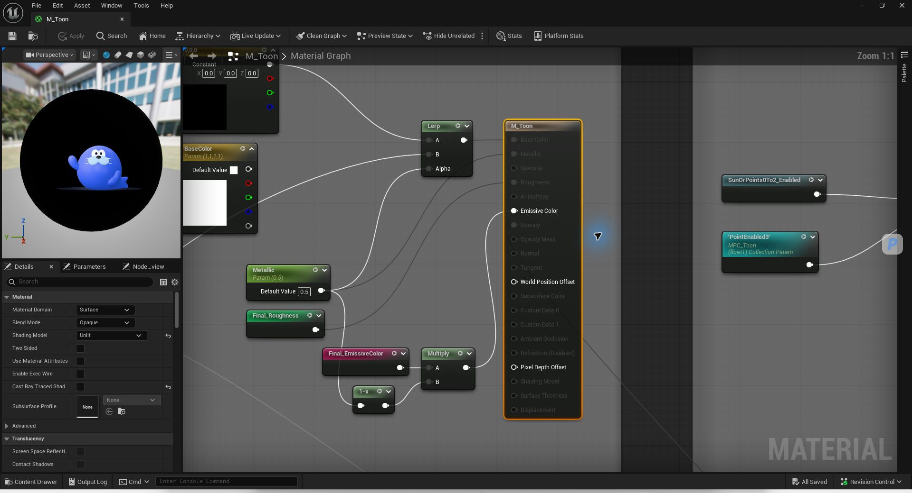
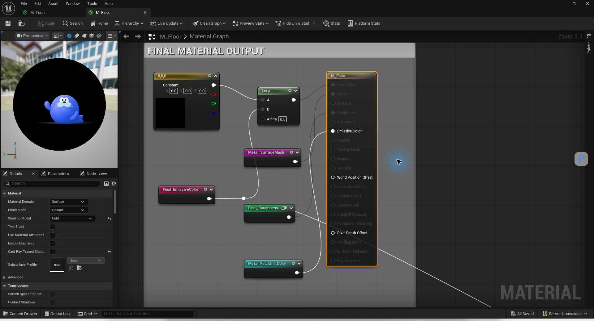

# Casino Shader — M_Toon / M_Floor

这两张图是 Unreal 材质编辑器的真实节点截图，聚焦最终输出区；不是把所有节点缩到一张图里。材质逻辑未改动。以下流程说明还依据实际材质节点与 Custom HLSL 的读取结果。

## M_Toon：自己计算光照，再输出卡渲颜色

大致流程：**材质颜色与法线 → 读取 MPC_Toon 中的光源数据 → 计算光照与笔刷式明暗色带 → 组合最终颜色 → Emissive Color。**

- 材质使用 **Unlit**。场景中的 Toon 灯把位置、范围、强度和启用状态写入材质参数集合；节点读取这些数据，自己计算受光表现。
- 图中有 8 组点光源函数。明暗、笔刷纹理与颜色调色板组合出风格化的表面颜色。移动灯的位置，因此会改变表面的明暗分界。
- 最终颜色通过命名连接 `Final_EmissiveColor` 汇入输出区。截图中的 `Multiply`、`1-x` 与 `Metallic` 控制输出混合；Base Color / Roughness 的连线在 Unlit 模式下不是主要可见光照来源。
- 材质还包含聚光灯的深度投影、3×3 PCF 可见性和笔刷边缘处理，以及可选的手部固定色带分支。这些分支是否生效取决于实例参数与场景配置，截图不代表全部同时启用。

## M_Floor：在卡渲基础上加入房间反射和金属高光

大致流程：**卡渲表面颜色 + 房间 Cubemap 反射 + 各光源金属高光 → 金属区域混合 → Metal_FinalUnlitColor → Emissive Color。**

- 同样使用 **Unlit**，保留自定义的明暗色带。
- `Room Reflection` 根据视线与法线计算反射方向，使用房间包围盒修正 Cubemap 的采样方向；粗糙度控制采样的 mip 与反射强度。
- `Light Highlights` 用法线、视线、光源方向、范围和强度计算高光，并加入 Fresnel。
- 最终 Custom 节点把 Toon 颜色、反射与高光组合。`Metal_SurfaceMask` 控制金属区域，结果通过 `Metal_FinalUnlitColor` 输出到 Emissive。这样可以在自定义卡渲里保留随视角和灯光变化的金属表现。

## English summary

**M_Toon:** An Unlit shader computes stylized lighting from `MPC_Toon`, with eight point-light function branches, brush-shaped lighting bands, and palette blending. The resulting color is routed to Emissive. Optional spotlight depth/PCF and fixed hand-palette branches depend on instance and scene settings.

**M_Floor:** The Unlit toon foundation is combined with box-projected room Cubemap reflections and custom per-light specular highlights. Roughness, Fresnel, metallic masks and light visibility shape the result; `Metal_FinalUnlitColor` feeds Emissive.
